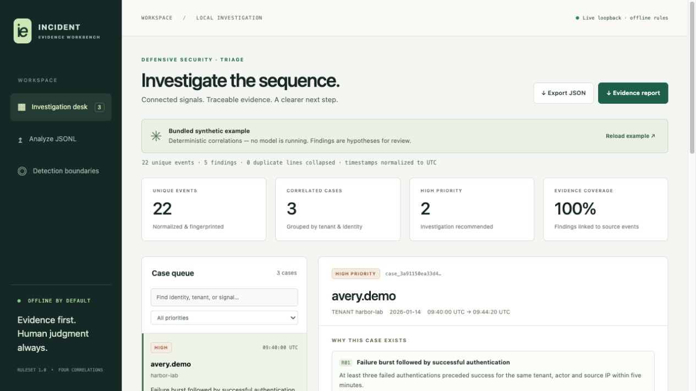

# Incident Evidence Workbench

[](https://github.com/demier-demier/incident-evidence-workbench/actions/workflows/checks.yml)

A local investigation desk that turns a bounded sequence of normalized security events into correlated cases, source evidence and specific human investigation steps. The core is deterministic and works offline. An optional loopback Ollama adapter can add an explicitly untrusted narrative without changing findings or taking actions.

**[Open the live browser demo](https://bernardo-demier-ai-lab.fancy-fly-9200.chatgpt.site/incident-evidence-workbench/)** — paste or choose JSONL, analyze, filter cases and inspect evidence without an account or installation.



The browser demo displays a computed synthetic example immediately. Clicking **Analyze evidence** downloads the pinned Pyodide Python runtime and runs the exact original `core.py` in a Web Worker. Event text is processed in the browser; there is no analysis backend or browser model integration. The first load needs a network connection and may take a minute. The hosting service and runtime CDN receive normal static-asset requests, but the app does not submit event text to them.

The [computed standalone preview](docs/demo.html) remains available for offline inspection and exports; it does not analyze new input. The local Python UI below also remains fully supported. See [browser architecture and verification](web/README.md).

## Run in under a minute

Python 3.11 or newer. No runtime dependencies, credentials, cloud account or model download.

```sh
python -m pip install .
python -m incident_workbench serve
```

Open **http://127.0.0.1:8765** in a browser. The UI analyzes only the bundled synthetic example on startup. Select **Analyze JSONL** to paste or choose a file, inspect each case's timeline, filter by priority or identity, and export JSON or a text evidence report. Stop the server with `Ctrl+C`.

Run directly from the source checkout without installing:

```sh
PYTHONPATH=src python -m incident_workbench serve
```

Compute the reproducible demo or analyze a file you explicitly select:

```sh
python -m incident_workbench demo --output-dir artifacts/demo
python -m incident_workbench analyze examples/synthetic-events.jsonl --output-dir artifacts/analysis
```

Each CLI run writes `results.json`, `demo.html` and `report.txt` to the chosen output directory. Existing artifacts at those three names are replaced. The browser server keeps no submitted logs, database or on-disk analysis history. Browser exports save only when selected.

## What is implemented

- **Strict JSONL ingestion:** exact per-event schemas; no unknown fields or implicit security defaults; timezone-aware UTC normalization; IP literal validation; duplicate JSON-key rejection; bounded bytes, event count and line size.
- **Stable evidence:** SHA-256 of each canonical normalized event, complete source line references for duplicates, and a hash of the exact submitted UTF-8 bytes. Hashes help compare evidence; they do not authenticate a log producer.
- **Four temporal correlations:** authentication failures followed by success; privileged role elevation after a matching session; API token source transition; and restricted records returned outside an explicit policy authorization label.
- **Case workbench:** tenant and identity boundaries, bounded case span, severity, reason, human investigation guidance, rule limitations, event timeline and complete normalized source evidence.
- **Constrained optional model output:** loopback IP transport, schema request, output validation, case-specific evidence references, response limits, deadline and no tool/action interface.

The committed synthetic example produces **22 unique events, 3 cases, and 5 findings**. It includes benign activity, a zero-record denied access, and the same identity in another tenant so that a recognizable pattern is not mistaken for cross-tenant evidence.

## Detection contract

| Rule | Signal | Required relationship | Window | Priority |
|---|---|---|---|---|
| R01 | ≥3 failures → successful authentication | Same tenant, actor and source IP; earlier success resets failures | ≤5 minutes | High |
| R02 | Authentication → member/viewer elevated to admin/owner | Same tenant, actor, session and source IP | ≤10 minutes | High |
| R03 | Expected → unexpected token source | Same tenant, actor and token reference; different source IP | ≤10 minutes | Medium |
| R04 | Authentication → restricted data returned outside policy | Same tenant, actor, session and source IP; `authorized=false`, `records>0` | ≤10 minutes | High |

Every correlation requires strictly increasing timestamps. Input order does not create temporal order. Exact boundary times are included; simultaneous events are not correlated as preceding/following. Duplicate normalized events count once toward rules.

Cases group findings for the same tenant and actor only when the entire combined evidence span is at most 15 minutes. The earliest evidence anchor never moves forward, so chains cannot extend a case indefinitely. Separate sessions may share a case when identity and time match; individual rule evidence still obeys its own session and source constraints. Full behavior and false positive/negative limits are in [the rule guide](docs/RULES.md).

## Event input

See [the schema reference](docs/EVENTS.md) and [synthetic JSONL](examples/synthetic-events.jsonl). This is a deliberately small **normalized event format**, not a parser for arbitrary identity-provider, cloud or SIEM logs. A real integration needs an adapter that preserves original provenance and validates the meanings of `authorized`, `expected_source`, `records` and identity/session fields. Unknown values must remain unknown upstream; inventing a boolean just to pass validation is incorrect.

```json
{"timestamp":"2026-01-14T09:42:25Z","tenant":"harbor-lab","actor":"avery.demo","type":"auth_success","source_ip":"192.0.2.41","session":"session-a"}
```

## Optional loopback model narrative

The UI always runs the deterministic engine. Model access is an explicit **CLI-only** option. Supply an already installed local model and an exact loopback IP endpoint:

```sh
python -m incident_workbench analyze examples/synthetic-events.jsonl \
  --ollama-endpoint http://127.0.0.1:11434/api/chat \
  --ollama-model YOUR_INSTALLED_LOCAL_MODEL \
  --output-dir artifacts/model-review
```

The adapter does not install Ollama or download models. It sends only correlated case evidence, requests structured JSON, rejects unknown case IDs, cross-case or invented evidence IDs, extra output fields and tool calls, and labels accepted prose **untrusted model narrative**. Model failure leaves the rule result intact and records `model.status=rejected`. It does not fail the offline analysis command.

A loopback endpoint verifies transport destination, **not where the daemon performs inference**. The operator must ensure the model and daemon are configured for on-device inference with cloud routing disabled. Cloud-marked model names are rejected, but aliases or a local proxy can still forward data. The current integration is verified against a local protocol stub only; **actual Ollama/model behavior and narrative quality are untested**. Valid schema and evidence IDs do not prevent incorrect statements, invented relationships or prompt injection in prose. See [the security and model boundary](docs/SECURITY_MODEL.md).

## Build the static browser demo

```sh
python web/build.py
```

The deterministic build writes `web/dist/` (ignored), including the unmodified Python core, shared UI, computed example, fixed-code worker and SHA-256 asset manifest. All paths work beneath `/incident-evidence-workbench/`. Serve the build through HTTPS or localhost; opening `index.html` directly as a file cannot start the module worker. The browser runtime is pinned to Pyodide **314.0.7**, checked against the official project documentation. No JavaScript copy of the correlation rules exists.

## Verify

```sh
python -m unittest discover -s tests -v
python -m incident_workbench demo --output-dir artifacts/verified-demo
python web/build.py
node --test web/test_worker_contract.mjs
```

Tests cover input normalization, duplicate and count limits, temporal/tenant/identity boundaries, evidence-span grouping, local HTTP Host/Origin/CSRF checks, allowlisted routes, report injection escaping, and local-stub narrative schema, references, timeout and redirect failures. CI is configured for Python 3.11–3.13; a configured matrix is not evidence that every job has already passed.

## Intended scope

A working defensive portfolio product and integration starting point. It does not scan networks, execute attacks, enrich from external services, collect logs automatically, revoke tokens, modify permissions or remediate systems. It has no authentication system, durable chain of custody, multiuser isolation, production SIEM integration or calibrated alert precision/recall. Findings are investigative hypotheses, not confirmed incidents. The input and model limits deliberately favor a small reviewable evidence set.

All fixture events and public examples are original synthetic material. See [provenance](PROVENANCE.md) for source references and what has—and has not—been validated.
